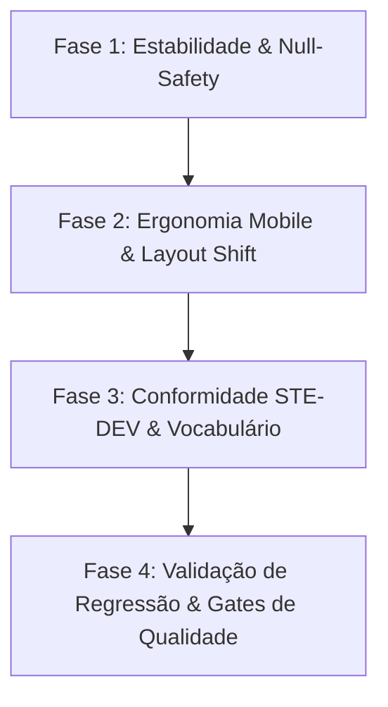

# Plano de Correções — Lucathi Wealth OS (LWOS)

**Localização:** `c:\apps\LWOS`  
**Escopo Exclusivo:** Correções de estabilidade de front-end, ergonomia mobile, conformidade com a metodologia [STE-DEV](file:///c:/apps/LWOS/.agents/skills/ste-dev/SKILL.md) e garantia de regressão contínua.

---

## 1. Visão Geral das Fases



---

## 2. Detalhamento das Etapas

### Fase 1: Estabilidade de Runtime & Blindagem Defensiva (Null-Safety)
> **Objetivo:** Eliminar qualquer risco de `TypeError: Cannot read properties of undefined` em carregamento assíncrono ou APIs retornando coleções parciais.

- [ ] **1.1. Painel Societário ([CompanyPanel.tsx](file:///c:/apps/LWOS/client/src/features/companies/CompanyPanel.tsx))**
  - **Linha 76:** Aplicar fallback seguro no cálculo de participação societária:
    ```typescript
    const total = (rows ?? []).reduce((sum, row) => sum + Number(row.percentage || 0), 0);
    ```
  - **Linhas 97-99:** Proteger a verificação de existência e iteração de sócios com `(rows ?? []).length > 0` e `rows?.map(...)`.
  - **Linha 202:** Proteger lista de titulares vinculados com `people?.map(...) ?? null`.

- [ ] **1.2. Painel de Ativos ([AssetsPanel.tsx](file:///c:/apps/LWOS/client/src/features/assets/AssetsPanel.tsx))**
  - **Linha 156:** Adicionar optional chaining na seleção de proprietários: `(people ?? []).map(person => ...)`.

- [ ] **1.3. Painel de Certidões ([CertidaoPanel.tsx](file:///c:/apps/LWOS/client/src/features/certidoes/CertidaoPanel.tsx))**
  - **Linha 248:** Blindar o filtro de escopo: `const scoped = (rows ?? []).filter(row => row.scope === scope);`.
  - **Linha 287 e 325:** Tratar iteração de `items` e contagem de `rows` com operadores defensivos.

- [ ] **1.4. Repositório de Documentos ([DocumentPanel.tsx](file:///c:/apps/LWOS/client/src/features/documents/DocumentPanel.tsx) e [groupDocuments.ts](file:///c:/apps/LWOS/client/src/features/documents/groupDocuments.ts))**
  - **Linha 78:** Mapear `(documents ?? []).map(...)`.
  - **Linhas 209, 242, 248:** Garantir que `group.documents` nunca seja undefined: `(group.documents ?? []).filter(...)`.
  - **groupDocuments.ts (94-96):** Proteger instanciação de Maps: `new Map((ctx.people ?? []).map(...))`.

---

### Fase 2: Ergonomia Mobile & Eliminação de Layout Shift
> **Objetivo:** Garantir fidelidade de layout em viewports móveis (< 768px) e conformidade com alvos de toque mínimos (48px).

- [ ] **2.1. Skeleton da Barra Lateral ([DashboardLayoutSkeleton.tsx](file:///c:/apps/LWOS/client/src/components/DashboardLayoutSkeleton.tsx))**
  - **Linha 7:** Adicionar a classe `hidden md:block` na div de 280px para evitar deslocamento de tela (CLS) em smartphones durante o carregamento inicial.

- [ ] **2.2. Botão Flutuante da IA ([AIChatBox.tsx](file:///c:/apps/LWOS/client/src/components/AIChatBox.tsx))**
  - **Linha 324:** Ampliar o alvo de toque de `h-[38px] w-[38px]` para `h-12 w-12` (48px), assegurando ergonomia recomendada pelo padrão mobile e adicionando `aria-label="Abrir assistente virtual"`.

- [ ] **2.3. Containers com Rolagem Horizontal Suave**
  - Garantir que as tabelas de dados em [ComponentShowcase.tsx](file:///c:/apps/LWOS/client/src/pages/ComponentShowcase.tsx) e nas listagens de imóveis e certidões possuam o container envolvente com `overflow-x-auto`.

---

### Fase 3: Conformidade Arquitetural STE-DEV (< 100 linhas e Vocabulário)
> **Objetivo:** Adequar a estrutura do front-end às regras estritas do [STE-DEV](file:///c:/apps/LWOS/.agents/skills/ste-dev/SKILL.md) presentes em `.agents/skills/ste-dev/SKILL.md`.

- [ ] **3.1. Eliminação do Termo Vago `utils.ts`**
  - O STE-DEV veta termos genéricos como `utils` e `helpers`.
  - Renomear [client/src/lib/utils.ts](file:///c:/apps/LWOS/client/src/lib/utils.ts) para `formatClasses.ts` (ou `cn.ts`) e atualizar os imports dos componentes de UI.

- [ ] **3.2. Modularização de Modais e Painéis Monolíticos**
  - **[CompanyDetailsModal.tsx](file:///c:/apps/LWOS/client/src/features/companies/CompanyDetailsModal.tsx) (638 linhas):**
    - `CompanyModalHeader.tsx` (< 50 linhas)
    - `CompanyBasicInfoForm.tsx` (< 90 linhas)
    - `CompanyShareholdersTable.tsx` (< 90 linhas)
    - `CompanyModalActions.tsx` (< 50 linhas)
  - **[PropertyFormModal.tsx](file:///c:/apps/LWOS/client/src/features/properties/PropertyFormModal.tsx) (615 linhas):**
    - `PropertyUrbanFields.tsx` (< 80 linhas)
    - `PropertyRuralFields.tsx` (< 80 linhas)
    - `PropertyEncumbranceSection.tsx` (< 70 linhas)
  - **[PersonForm.tsx](file:///c:/apps/LWOS/client/src/features/people/common/PersonForm.tsx) (467 linhas):**
    - Subdividir em `PersonIdentityFields.tsx`, `PersonContactFields.tsx` e `PersonSpouseFields.tsx`.

- [ ] **3.3. Eliminação de `any` Explícito**
  - Tipar estritamente o evento de composição em:
    - [components/ui/dialog.tsx:107](file:///c:/apps/LWOS/client/src/components/ui/dialog.tsx#L107)
    - [components/ui/input.tsx:25](file:///c:/apps/LWOS/client/src/components/ui/input.tsx#L25)
    - [components/ui/textarea.tsx:24](file:///c:/apps/LWOS/client/src/components/ui/textarea.tsx#L24)
    - [hooks/usePersistFn.ts:3](file:///c:/apps/LWOS/client/src/hooks/usePersistFn.ts#L3) (substituir por genérico `(...args: unknown[]) => unknown`).

---

### Fase 4: Validação, Regressão e Quality Gate
> **Objetivo:** Assegurar que nenhuma alteração quebre regras existentes nem reduza a cobertura de testes.

- [ ] **4.1. Verificação de Tipos:**
  ```powershell
  pnpm check
  ```
- [ ] **4.2. Suíte de Testes Unitários e Integração:**
  ```powershell
  pnpm test
  ```
- [ ] **4.3. Cobertura de Código:**
  ```powershell
  pnpm test:coverage
  ```
- [ ] **4.4. Build Completo do Pacote:**
  ```powershell
  pnpm build
  ```

---

## 3. Ordem de Execução Recomendada

1. **Sprint 1 (Imediato):** Executar **Fase 1** (Null-safety em `CompanyPanel`, `AssetsPanel`, `CertidaoPanel`, `DocumentPanel`) + **Fase 2** (Layout Shift no Skeleton). São alterações não invasivas e de retorno imediato na estabilidade.
2. **Sprint 2:** Executar **Fase 3.1** e **3.3** (Eliminação de `utils.ts` e remoção dos tipos `any`).
3. **Sprint 3:** Desacoplamento modular dos modais (Fase 3.2), preservando todos os contratos e submetendo a bateria completa da Fase 4.
